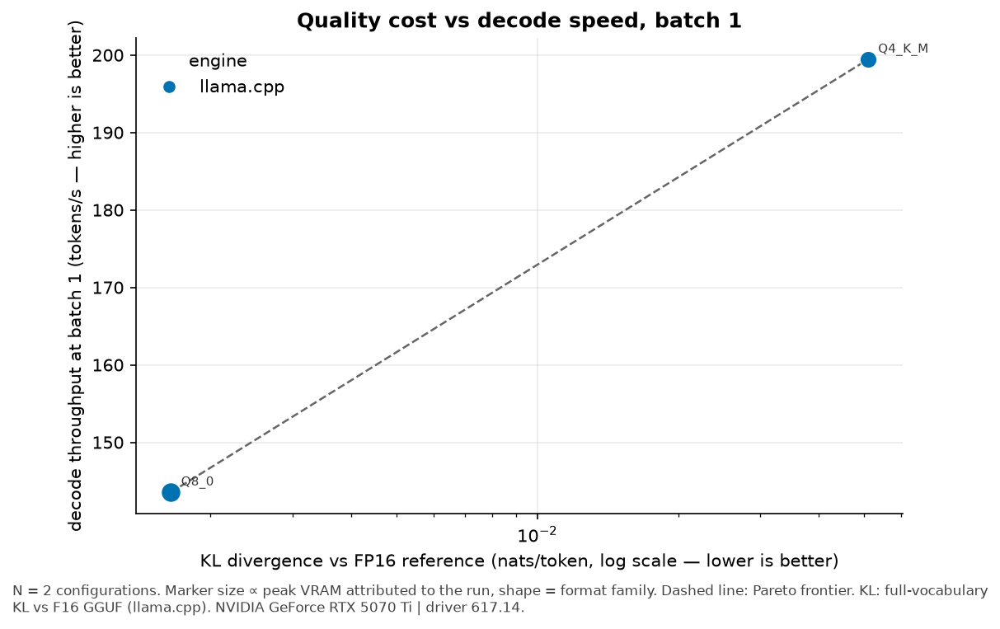

# quant-bench-5070ti

**Which quantization format and inference engine should you actually run on a 16 GB
consumer card, and what exactly do you give up?**

A reproducible single-card benchmark matrix for the NVIDIA RTX 5070 Ti (Blackwell GB203,
`sm_120`, 16 GB GDDR7), covering GGUF K-quants and i-quants, AWQ, GPTQ, FP8, NF4 and EXL3
across llama.cpp, vLLM, ExLlamaV3 and HF Transformers.

> **Status: M1 complete on real hardware; quality (M2) not yet measured.**
> First runs: 2026-10-17, RTX 5070 Ti, driver 617.14, llama.cpp b11706, native Windows 11.
> Only the `smoke` latency profile has run, so most tables below still render `—`. This
> repo never prints an estimate in place of a measurement — see
> [Agent working agreement §0](requirements.md#0-agent-working-agreement).
>
> Host caveat: Windows WDDM gives no per-process VRAM accounting, and other processes held
> ~4.7 GiB of the card during these runs. VRAM figures are attributed as device-wide peak
> minus pre-load baseline; see [methodology](docs/methodology.md#vram-accounting-modes).

---

## The hero chart



_Figure 1 — quality cost (KL divergence vs the FP16 reference, log x, lower is better)
against decode throughput at batch 1. Marker size ∝ peak VRAM, colour = engine, shape =
format family, dashed line = Pareto frontier. **Not yet generated: no runs have been
executed.**_

## Recommendation table

<!-- BEGIN quantbench:recommendations -->
_No data yet. Run the benchmark; cells stay — until a run record exists._

Configurations whose IQRs overlap are reported as tied rather than ranked (§6.9). Peak VRAM is process-level NVML, the figure that decides whether it fits.
<!-- END quantbench:recommendations -->

## Hypotheses

Stated up front, answered with data. Confirming, refuting, or being unable to resolve any
of them is an acceptable outcome.

- **H1** — Q5_K_M is a strictly better quality-per-VRAM tradeoff than Q4_K_M for models
  ≤ 8B, but the ordering inverts once KV-cache pressure at long context dominates.
- **H2** — Perplexity delta materially understates quantization damage compared to KL
  divergence against the FP16 reference; two quants with near-identical PPL can differ
  substantially in top-1 token agreement.
- **H3** — On `sm_120`, INT4 formats with Marlin-class kernels (AWQ/GPTQ via vLLM) beat
  GGUF Q4_K_M on batched throughput, but GGUF wins or ties at batch size 1 — the regime
  most local users actually run.
- **H4** — KV-cache quantization buys more usable context per GB than weight quantization
  does, per unit of quality lost.

<!-- BEGIN quantbench:hypotheses -->
| hypothesis | statement | evidence | verdict |
| --- | --- | --- | --- |
| H1 | Q5_K_M beats Q4_K_M on quality-per-VRAM below 8B, inverting under KV pressure | data present — see docs/findings.md | — |
| H2 | PPL delta understates quantization damage relative to KL divergence | insufficient data | — |
| H3 | INT4 + Marlin-class kernels beat GGUF Q4_K_M batched, but not at batch 1 | data present — see docs/findings.md | — |
| H4 | KV-cache quantization buys more usable context per GB than weight quantization | data present — see docs/findings.md | — |
<!-- END quantbench:hypotheses -->

## What ran, what didn't

<!-- BEGIN quantbench:coverage -->
| model | format_variant | ok |
| --- | --- | --- |
| Qwen3-4B | gguf:Q4_K_M | 1 |
| Qwen3-4B | gguf:Q8_0 | 1 |
<!-- END quantbench:coverage -->

Build failures and unsupported paths are published in [docs/failures.md](docs/failures.md)
with exact versions and errors. That file is a credibility asset, not an embarrassment.

## Latency, memory and power measurements

<!-- BEGIN quantbench:latency -->
| model | format | engine | batch | prompt | gen | decode tok/s (p50) | IQR | TTFT ms (p50) | ITL ms (p50) | ITL ms (p99) | peak VRAM MiB (run) | eff. bpw | tok/J | power-capped |
| --- | --- | --- | --- | --- | --- | --- | --- | --- | --- | --- | --- | --- | --- | --- |
| Qwen3-4B | gguf:Q4_K_M | llama.cpp | 1 | 512 | 128 | 184.71 | 0.68 | 64.86 | 5.17 | 7.48 | 2,810.86 | 4.78 | 0.77 | 21% |
| Qwen3-4B | gguf:Q8_0 | llama.cpp | 1 | 512 | 128 | 143.04 | 0.37 | 60.04 | 6.91 | 8.43 | 4,519.29 | 8.50 | 0.62 | 0% |

Medians over measured repetitions; IQR is of per-request decode rate. Rows whose IQRs overlap are statistically indistinguishable (§6.9). Peak VRAM is attributable to the run; see the VRAM note in docs/methodology.md for how that is defined per host.
<!-- END quantbench:latency -->

## Measurement environment

<!-- BEGIN quantbench:environment -->
| gpu_name | driver | engine | engine_version | is_wsl | vram_accounting |
| --- | --- | --- | --- | --- | --- |
| NVIDIA GeForce RTX 5070 Ti | 617.14 | llama.cpp | b11706 | False | device_wide |
<!-- END quantbench:environment -->

---

## Reproduce it

Without a GPU — regenerate every figure from the committed results:

```bash
uv sync --extra dev
uv run quantbench plot --results results/results.parquet --out figures/
```

With a 16 GB Blackwell card:

```bash
uv run quantbench preflight                 # asserts sm_120 is in torch's arch list
uv run quantbench models fetch --config configs/models/qwen3-8b.yaml
uv run quantbench quantize --model qwen3-8b --formats gguf:Q4_K_M,gguf:Q5_K_M,awq,exl3:4.0
uv run quantbench reference build --model qwen3-8b
uv run quantbench plan --profile core --out plan.core.json
uv run quantbench run --plan plan.core.json --resume
uv run quantbench analyze && uv run quantbench plot && uv run quantbench report
```

`make core` chains plan → run → analyze → plot → report. Engine environments install
separately (`requirements/{hf,vllm,exl3}.txt`) because their torch pins conflict; see
[docs/install/](docs/install/).

Dry-run the whole pipeline on a machine with no GPU at all:

```bash
uv run quantbench plan --profile smoke --out plan.smoke.json
uv run quantbench run --plan plan.smoke.json --dry-run
```

Dry-run output is produced by a mock engine, marked `synthetic: true`, written to
`results/dryrun/`, and excluded from analysis by default. It exercises the schema and the
pipeline; it says nothing about hardware.

## How the numbers are made

The full protocol is in [docs/methodology.md](docs/methodology.md). The parts that matter
most:

- **KL divergence against the FP16 reference is the primary quality metric**, not
  perplexity. A quant can post *lower* PPL than its own FP16 parent while being
  demonstrably less faithful.
- **Per-token arrival timestamps** are recorded for every request, so ITL p90/p95/p99 are
  measured rather than inferred. Tail latency is invisible in a mean.
- **Four separate VRAM numbers** — weights, KV cache, allocator peak, and process-level
  NVML peak. Only the last one decides whether a configuration actually fits.
- **Randomized, interleaved run order** with a recorded seed, plus a cooldown gate, so GPU
  temperature drift is not confounded with format.
- **One subprocess per run**: an OOM or a segfault costs one data point, not the session,
  and `OOM` is a recorded outcome rather than an exception.
- **Statistical honesty**: medians and IQRs. Configurations whose IQRs overlap are reported
  as tied, not ranked.

## Non-goals

Absence here is deliberate, not oversight:

- Training, fine-tuning, LoRA (NF4 appears only as an *inference* baseline).
- Multi-GPU, tensor parallelism, distributed serving.
- CPU-only or Apple Silicon inference.
- Subjective "vibe" evaluation or LLM-as-judge scoring.
- Production serving concerns: autoscaling, routing, auth.
- Beating published SOTA numbers. The contribution is methodology plus a reproducible
  single-card matrix.
- Datacenter Blackwell (`sm_100`). Findings are scoped to consumer GB20x.

## Limitations

- Single GPU, single sample of one card: silicon lottery and cooling are uncontrolled.
- Engine version churn — results are a dated snapshot with every version pinned per record.
- Cross-engine perplexity is not directly comparable; quality metrics are computed in one
  harness over one token stream wherever possible, and labelled `scored_by_engine` where
  not.
- If measurements are taken under WSL2, batch-1 latency is noisier than native Linux. The
  `is_wsl` flag is recorded in every run record and surfaces in the environment table.

## Layout

```
configs/    hardware, models, formats, run profiles, eval definitions
src/        the harness (schema, planner, runner, engines, metrics, analysis)
results/    raw/<run_id>.json (never edited) + results.parquet
figures/    committed SVG + PNG, regenerable without a GPU
docs/       methodology, findings, failures, open questions, install recipes
```

## License

MIT. See [LICENSE](LICENSE) and [CITATION.cff](CITATION.cff).
